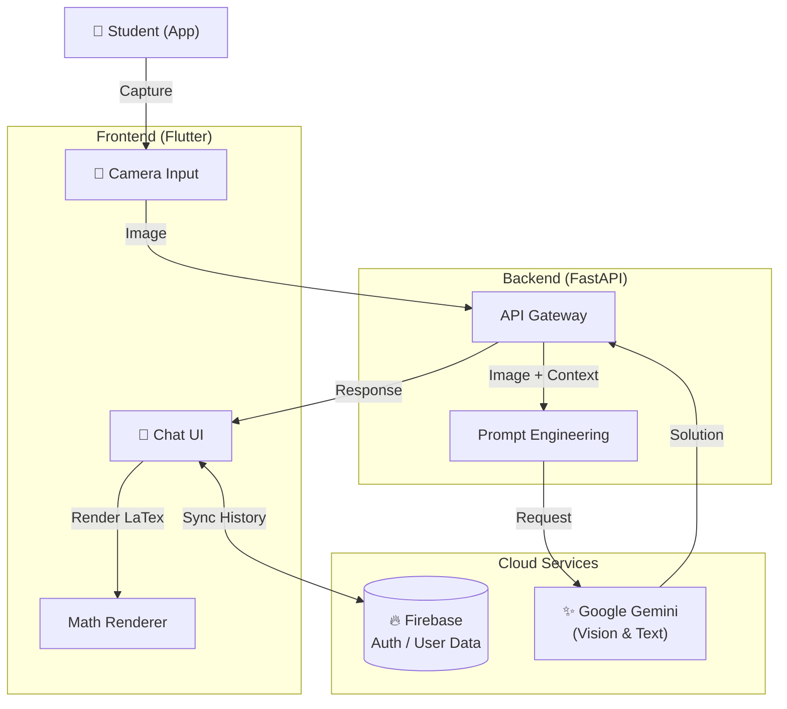

# AITH - AI Tutor for Homework 🎓

<p align="center">
  <b>「宿題は、もう怖くない」</b><br>
  AI-Powered Homework Assistant & Personal Tutor
</p>


---

## 📖 概要 (Overview)

**AITH** は、カメラで撮るだけで宿題を解説し、個別の学習計画まで立ててくれる、あなたの手のひらの「AI家庭教師」です。
単なる答えの提示ではなく、**「なぜそうなるのか」** というプロセスを重視。3つの異なるペルソナ（優しい先生、熱血コーチなど）が、生徒のモチベーションに合わせて学習をサポートします。

## ✨ Features

### 📸 Camera Analysis
- **数式認識:** 手書きの複雑な数式も、写真を撮るだけでLaTeX変換し、ステップバイステップで解法を提示。
- **図形問題:** 幾何学問題も視覚的に認識し、補助線を引くようなイメージで解説します。

### 💬 AI Chat
- **Persona System:** 「褒めて伸びるタイプ」には優しい先生を、「厳しく管理されたい」なら鬼コーチを。気分に合わせてAIの人格を切り替え可能。
- **Context Aware:** 過去の質問内容やニガテ分野を記憶し、対話を重ねるごとに指導が最適化されます。

### 📚 Learning Tools
| Feature | Description |
|---------|-------------|
| 🎴 **Smart Flashcards** | 忘却曲線に基づいた暗記カード機能 |
| 📝 **Essay Correction** | 小論文や英作文の添削・フィードバック |
| 🎤 **Interview Prep** | 模擬面接シミュレーター（音声対応） |
| 🗣️ **English Conversation** | シナリオベースの英会話ロールプレイ |

---

## 🏗️ Tech Stack

| Layer | Technology | Usage |
| :--- | :--- | :--- |
| **Frontend** | **Flutter (Dart)** | Cross-platform Mobile App |
| **Backend** | **FastAPI (Python)** | High-performance Async API |
| **AI Engine** | **Google Gemini 1.5** | Multi-modal Reasoning |
| **Database** | **Firebase Firestore** | Real-time Data Sync |
| **Math** | **flutter_math_fork** | LaTeX Rendering |

---

## 🧩 アーキテクチャ (Architecture)



## 📁 Project Structure

```
AITH/
├── app/                    # Flutter Application
│   ├── lib/
│   │   ├── main.dart       # Main app with all screens
│   │   ├── constants.dart  # Backend URL, navigation constants
│   │   ├── screens/        # Extracted screen modules
│   │   ├── widgets/        # Reusable widgets
│   │   └── utils/          # LaTeX processing utilities
│   └── pubspec.yaml
├── backend/                # FastAPI Backend
│   ├── main.py             # API endpoints
│   ├── requirements.txt
│   └── Dockerfile
└── .env                    # API keys (gitignored)
```

## 🔒 Security Notes

- `.env` and Firebase credentials are **gitignored**
- Never commit API keys to the repository
- CORS is configured for development (restrict in production)

## 🔗 Related Projects

Part of the [Enludus](https://enludus.com) ecosystem.

## 📄 License

MIT
