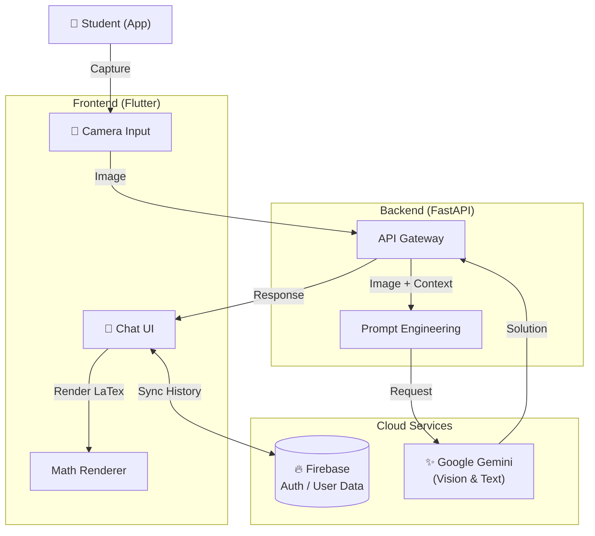

# AITH - AI Tutor for Homework 🎓

<p align="center">
  <b>"Homework, Fear No More"</b><br>
  AI-Powered Homework Assistant & Personal Tutor
</p>


---

[🇯🇵 Japanese (日本語)](README.ja.md)

## 📖 Overview

**AITH** is your palm-sized "AI Tutor" that explains homework and creates personalized study plans just by taking a photo.
It emphasizes the process of **"Why it works that way"** rather than just providing answers. Three different personas (Gentle Teacher, Passionate Coach, etc.) support learning according to the student's motivation.

## ✨ Features

### 📸 Camera Analysis
- **Math Recognition:** Instantly converts handwritten complex formulas to LaTeX and provides step-by-step solutions just by snapping a photo.
- **Geometry Problems:** Visually recognizes geometric problems and explains them with auxiliary lines.

### 💬 AI Chat
- **Persona System:** Choose a "Gentle Teacher" for praise-based learning, or a "Strict Coach" for disciplined management. Switch AI personalities to match your mood.
- **Context Aware:** Remembers past questions and weak areas, optimizing guidance as you interact more.

### 📚 Learning Tools
| Feature | Description |
|---------|-------------|
| 🎴 **Smart Flashcards** | Memorization cards based on the forgetting curve |
| 📝 **Essay Correction** | Correction and feedback for essays and English composition |
| 🎤 **Interview Prep** | Mock interview simulator (Voice enabled) |
| 🗣️ **English Conversation** | Scenario-based English conversation roleplay |

---

## 🏗️ Tech Stack

| Layer | Technology | Usage |
| :--- | :--- | :--- |
| **Frontend** | **Flutter (Dart)** | Cross-platform Mobile App |
| **Backend** | **FastAPI (Python)** | High-performance Async API |
| **AI Engine** | **Google Gemini 1.5** | Multi-modal Reasoning |
| **Database** | **Firebase Firestore** | Real-time Data Sync |
| **Math** | **flutter_math_fork** | LaTeX Rendering |

---

## 🧩 Architecture



## 📁 Project Structure

```
AITH/
├── app/                    # Flutter Application
│   ├── lib/
│   │   ├── main.dart       # Main app with all screens
│   │   ├── constants.dart  # Backend URL, navigation constants
│   │   ├── screens/        # Extracted screen modules
│   │   ├── widgets/        # Reusable widgets
│   │   └── utils/          # LaTeX processing utilities
│   └── pubspec.yaml
├── backend/                # FastAPI Backend
│   ├── main.py             # API endpoints
│   ├── requirements.txt
│   └── Dockerfile
└── .env                    # API keys (gitignored)
```

## 🔒 Security Notes

- `.env` and Firebase credentials are **gitignored**
- Never commit API keys to the repository
- CORS is configured for development (restrict in production)

## 🔗 Related Projects

Part of the [Enludus](https://enludus.vercel.app/) ecosystem.

## 📄 License

MIT
